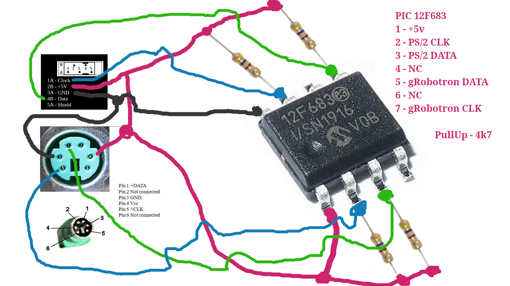
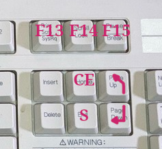
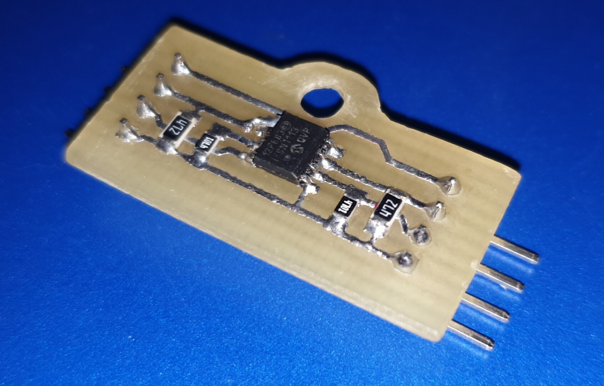
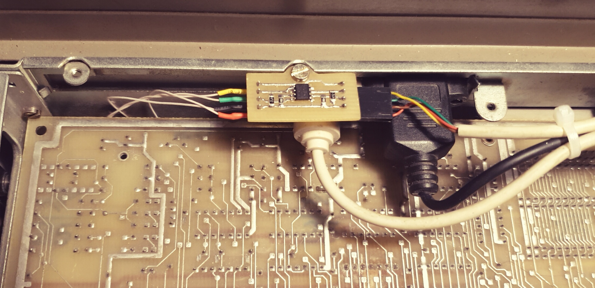

# PS/2 Keyboard Converter for gRobotron 1715

A simple PS/2 keyboard-to-Robotron 1715 converter based on the PIC12F683. Support for ASCII control characters. The Left Alt+Shift key combination functions similarly to the SI/SO control characters for switching character sets.

[12f683_ps2_to_r1715](firmware/12f683_ps2_to_r1715.hex)

### Update
Fixed: The digits 3 and 4 were swapped. The `>` symbol was not being processed when the Shift key was held down.
A major bug with F7 has been fixed, and the issue with Print Screen (F13) has also been resolved. A bug remains where the Pause key (F15) is sent twice; I’ll look into that later, if I feel like it.

## Wiring

All you will need is a 12F683 and four 4.7kΩ resistors.

## Additional keys

The F13, F14, and F15 keys, along with several others, are located in a separate block of additional keys.

### Installing the board

